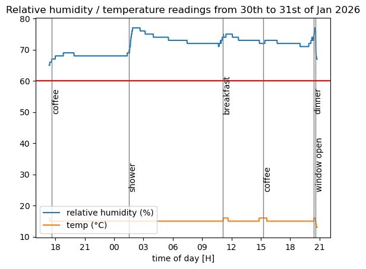

# Overview
This goal of this project is to log temperature and humidity over a given duration. This project was started as a means to assess the risk of mould development in my flat. 


# Hardware
The following hardware was used in this project: 
- Raspberrypi pico 2 with headers.
- A micro USB cable to connect the device to a laptop.
- Another linux device: in my case a Thinkpad T430 with Arch Linux (cliché I know).
- A suitable power supply to run the device when it's not plugged into the laptop. 
- Female to female jumper wires
- [humidity and temperature sensors](https://www.amazon.fr/-/en/dp/B0CK195FRJ?ref=ppx_yo2ov_dt_b_fed_asin_title)

# Setup
## Hardware
Wiring:
- DHT11 sensor (+) to GPIO 3V3
- DHT11 sensor (-) to GND
- DHT11 signal to GPIO 4

## Software
The exact development environment can be recreated using the Nix package manager. Nix is only available on Linux and Mac (sorry windows).
To open the environment, simply navigate to the project directory and run: 
```
nix-env
```
This will automatically install python + required library as well as the Thonny editor (easiest way of interacting with the raspberrypi). 


The project is written in micropython, which must be set up on the board. To do so, plug the board into the laptop while holding the bootsel button. The pico should appear as mass storage option in the file browser. 
Then, simply install the micropython `.uf2` file (available [here](https://micropython.org/download/RPI_PICO/)), and slide it onto the pico from the file browser.

Following this, the pico should appear when opening the Thonny editor (look at the bottom left of the screen). 
Finally, run the `/pico/main.py` in Thonny. Temperature and humidity logs should then appear. These are acquired every minute. 

When running, the data is automatically saved to the board's flash memory as data.csv. This data can be transferred from the pico to the computer using the Thonny file browser. 

## Usage
Unplug the board from the laptop, and transfer it to an external supply. Let it run for the required amount of time before plugging it back into the laptop to collect the csv data over Thonny. 
The data can then be analysed using the `data_analyser.ipynb`. 
To do so, open jupyter lab by running
```
jupyter lab .
```
in the nix environment we created earlier.
